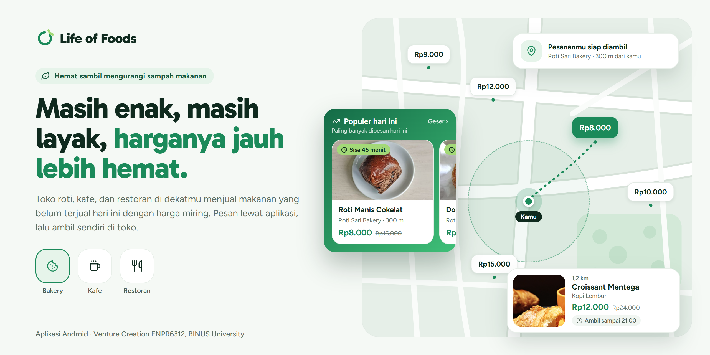
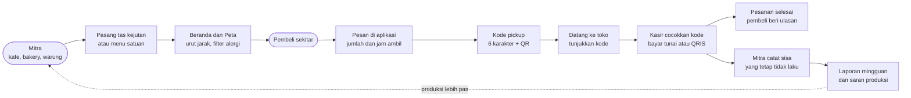

<p align="center">
  
</p>

# Life of Foods

[](https://github.com/Bambang-Saputra/Venture-Creation/actions/workflows/android-ci.yml)
[](https://github.com/Bambang-Saputra/Venture-Creation/actions/workflows/api-ci.yml)

Aplikasi Android untuk membeli makanan yang belum terjual hari ini dari toko roti, kafe, dan restoran di sekitarmu, dengan harga jauh lebih murah. Makanannya masih enak dan layak dimakan, hanya saja tidak habis sebelum toko tutup. Pembeli memesan lewat aplikasi, datang ke toko di jam yang ditentukan, menunjukkan kode pesanan ke kasir, lalu membayar tunai atau QRIS di tempat.

**Mata kuliah:** Venture Creation (ENPR6312), BINUS University
**Isu:** SDG 12, konsumsi dan produksi yang bertanggung jawab

---

## Daftar Isi

1. [Apa Itu Life of Foods?](#apa-itu-life-of-foods)
2. [Coba Aplikasinya](#coba-aplikasinya)
3. [Masalah dan Solusi](#masalah-dan-solusi)
4. [Fitur Utama](#fitur-utama)
5. [Model Bisnis](#model-bisnis)
6. [Status Pengerjaan](#status-pengerjaan)
7. [Tech Stack](#tech-stack)
8. [Struktur Repo](#struktur-repo)
9. [Menjalankan dari Source Code](#menjalankan-dari-source-code)
10. [Aturan Kerja](#aturan-kerja)
11. [Desain](#desain)
12. [Banner dan Aset](#banner-dan-aset)

---

## Apa Itu Life of Foods?

Jam 9 malam di sebuah bakery di Tebet. Masih ada belasan roti di etalase, dan toko tutup sebentar lagi. Besok pagi roti itu tidak lagi dijual, jadi biasanya dibuang. Di saat yang sama, ada orang beberapa ratus meter dari sana yang mau makan malam enak tanpa keluar banyak uang.

**Life of Foods mempertemukan keduanya.** Toko memasang makanan yang belum terjual di aplikasi, pembeli di sekitar memesannya dengan harga jauh lebih murah, lalu mengambilnya sendiri sebelum toko tutup. Makanan bisa dijual satuan, atau dikemas dalam satu paket campur berisi beberapa jenis dengan harga lebih hemat lagi (di aplikasi disebut "tas kejutan").

Ada tiga prinsip yang kami pegang:

- **Jujur soal isi.** Kandungan, alergen, dan status halal ditulis apa adanya. Halal bersertifikat menyebut nomornya, klaim mitra ditulis sebagai klaim, dan yang tidak disebutkan ditulis "tidak disebutkan".
- **Nyaman dipakai.** Pesan dalam beberapa ketukan, tanpa top up dan tanpa dompet digital. Bayar di toko seperti biasa.
- **Aturan yang jelas.** Jam buka, jam ambil, dan batas waktu tampil di setiap jualan. Kode pickup kedaluwarsa 30 menit setelah jam ambil lewat, dan stoknya kembali ke mitra.

### Alur aplikasi



Panah putus-putus adalah bagian yang membedakan Life of Foods dari sekadar aplikasi diskon: dari catatan sisa harian, mitra mendapat laporan mingguan dan saran jumlah produksi, sehingga sisanya makin sedikit dari minggu ke minggu.

---

## Coba Aplikasinya

**APK:** belum ada rilis publik. Setiap kali tag `v*` didorong ke repo, workflow `android-apk-rilis` membangun APK debug dan melampirkannya di halaman [Releases](https://github.com/Bambang-Saputra/Venture-Creation/releases).

**Cara install di HP Android (minimal Android 8.1):**

1. Buka file APK yang sudah diunduh.
2. Jika muncul *"Install unknown apps"*, izinkan untuk browser atau aplikasi file yang dipakai.
3. Jika Google Play Protect memberi peringatan, pilih **More details**, lalu **Install anyway**. Peringatan ini muncul karena aplikasi tidak dipasang dari Play Store.

**Cara mencoba:**

| Ingin mencoba | Caranya |
|---|---|
| Alur pembeli | Pilih peran **Pembeli**, masuk dengan nomor HP, isi profil dan alergi, lalu pesan dari Beranda |
| Alur mitra | Pilih peran **Mitra**. Nomor yang belum terdaftar diarahkan ke formulir **Daftar usaha**, lalu menunggu tim menyetujui |
| Menukar kode | Pesan dari HP pembeli, lalu buka **Cocokkan kode** di HP mitra dan ketik kodenya atau pindai QR-nya |

> Selama uji coba, API berjalan di laptop tim dan dibuka lewat ngrok, jadi aplikasi hanya tersambung saat sesi demo berlangsung. Gateway OTP berbayar belum dipakai: dengan `PILOT_MODE=true`, kode OTP ditampilkan di layar dengan spanduk "mode uji coba". Pembayaran tidak lewat aplikasi; aplikasi hanya mencatat transaksi.

---

## Masalah dan Solusi

**Masalah.** Dunia membuang sekitar 1,05 miliar ton makanan pada 2022, kira-kira seperlima dari makanan yang tersedia untuk konsumen ([UNEP Food Waste Index Report 2024](https://www.unep.org/resources/publication/food-waste-index-report-2024)). Di level toko, makanan yang tidak terjual sebelum tutup menjadi kerugian langsung bagi pemilik usaha. Too Good To Go menyelesaikan masalah ini di Eropa tapi belum masuk Indonesia, sedangkan aplikasi lokal yang ada belum menonjolkan kejujuran soal isi dan harga.

**Solusi.** Life of Foods memberi mitra jalur cepat untuk menjual sisa hari itu, dan memberi pembeli alasan untuk percaya:

- Mitra memasang tas kejutan atau menu satuan dalam hitungan detik, dengan cetakan tas yang bisa dipakai ulang setiap hari.
- Pembeli melihat jualan terdekat, langsung tersaring sesuai alergi di profilnya.
- Pesanan dikunci dengan kode pickup, jadi mitra tidak perlu menyimpan makanan untuk orang yang tidak datang.
- Jualan yang tetap tidak laku otomatis masuk catatan sisa, jadi mitra tinggal memeriksa. Dari catatan itu mitra mendapat laporan rupiah mingguan dan saran produksi untuk mengurangi sisa di hari berikutnya.

---

## Fitur Utama

Kode layar (K untuk konsumen, M untuk mitra) mengikuti [peta layar Figma](docs/figma/peta-layar.md).

### Untuk pembeli

| Fitur | Keterangan |
|---|---|
| Onboarding (K06) | Tiga halaman pengenalan sebelum login, halaman terakhir meminta izin lokasi |
| Masuk (K02-K05) | Nomor HP dan OTP, lengkapi profil, simpan alergi dan pantangan |
| Beranda (K07) | Cari, kategori, "Tutup kurang dari satu jam", Populer hari ini, Terdekat dari kamu, banner iklan mitra |
| Peta (K08) | Penanda harga per toko di OpenStreetMap, tab Daftar urut jarak, buka aplikasi peta lewat `geo:` |
| Filter (K09) | Jenis jualan, alergi yang dihindari (terisi dari profil), pola makan, halal, jarak, dan jam ambil |
| Detail jualan (K10, K11) | Foto, harga normal dan harga jual, stok, jam ambil, kandungan, status halal apa adanya, rating toko, bagikan jualan ke WhatsApp |
| Ringkasan pesanan (K12, K13) | Satu tas utuh atau beberapa menu satuan dari toko yang sama, harga dicek ulang oleh server |
| Kode pickup (K14) | Kode 6 karakter dan QR, status realtime, tombol batalkan, jumlah porsi yang diselamatkan |
| Pesanan saya (K15) | Pesanan aktif dan riwayat, beri ulasan setelah pesanan selesai |
| Favorit dan notifikasi (K16, K17) | Simpan toko, pengingat 30 menit sebelum jam ambil, kabar saat toko favorit memasang jualan |
| Profil (K18-K20) | Ubah profil dan alergi, pengaturan, hapus akun |

### Untuk mitra

| Fitur | Keterangan |
|---|---|
| Daftar usaha (M03, M04) | Pendaftaran dari aplikasi tanpa KTP, NIB opsional, disetujui tim sebelum toko tampil |
| Dashboard (M05) | Kerugian yang tertahan minggu ini, pesanan menunggu, sisa harian rata-rata 7 hari |
| Catat sisa (M06, M19) | Jualan yang tidak laku hari itu terisi otomatis, mitra tinggal memeriksa. Hitung per item atau timbang per kilogram; nilai rupiah disimpan saat dicatat |
| Laporan dan saran (M07, M08) | Laporan mingguan dan saran jumlah produksi berdasarkan catatan sisa |
| Pasang dan kelola jualan (M09, M10, M16, M17) | Tas kejutan dari cetakan, menu satuan, foto jualan, jeda jualan |
| Pesanan masuk (M11, M21) | Catatan pembeli dan alergi tampil langsung di kartu pesanan, riwayat dengan "Muat lebih banyak" |
| Cocokkan kode (M12, M18) | Ketik kode atau pindai QR; kode ganda, kode toko lain, dan setiap penukaran tercatat di audit log |
| Saldo (M13) | Riwayat transaksi; pencairan tampil tapi nonaktif selama uji coba |
| Profil dan pengaturan toko (M14, M15) | Foto, jam buka, anggota toko dengan peran pemilik atau kasir |
| Promosikan toko (M22) | Pasang iklan per hari tayang: prioritas pencarian atau banner Beranda |

---

## Model Bisnis

| Sumber | Tarif | Keterangan |
|---|---|---|
| Biaya layanan | Rp1.000 per pesanan, dibayar pembeli | Sumber utama. Di awal ditanggung lewat voucher: gratis untuk pesanan pertama dan untuk program ajak teman. Kolom `service_fee` sudah ada di setiap pesanan; tarifnya diatur lewat `SERVICE_FEE` di `.env` tanpa mengubah kode (ADR-0004) |
| Prioritas pencarian | Rp5.000 per hari tayang | Sukarela dari mitra. Paling banyak 2 jualan berlabel "Iklan" di atas daftar utama. Filter alergi tetap berlaku |
| Banner Beranda | Rp10.000 per hari tayang | Sukarela dari mitra. Tampil di Beranda pembeli. Terpisah dari "Populer hari ini", yang murni dihitung dari pesanan |

**Mitra tidak membayar langganan maupun komisi.** Mitra sengaja melebihkan produksi supaya tidak kehabisan, jadi alat untuk "mengurangi produksi" bukan hal yang mau mereka bayar, dan di awal mitra adalah sisi yang paling sulit dicari. Laporan sisa dan saran produksi tetap gratis untuk membantu mitra tahu berapa kelebihan yang masih wajar. Kelebihan itulah yang disalurkan lewat aplikasi, sehingga pendapatan datang setiap kali makanan terselamatkan, bukan dari makanan yang terbuang.

**Voucher di awal** menjaga harga tetap menarik: biaya layanan tetap tampil tapi dicoret ("ditanggung Life of Foods"), dan berlaku dengan batas yang jelas supaya pembeli tidak kaget saat promo berakhir. Program ajak teman sekaligus memanfaatkan temuan riset bahwa pengaruh sosial paling mendorong orang mau mencoba.

Selama uji coba semuanya gratis: `SERVICE_FEE` bernilai 0, tagihan iklan belum memotong saldo, dan tim tidak memegang uang mitra karena pembeli membayar langsung di toko.

---

## Status Pengerjaan

| Bagian | Status |
|---|---|
| Alur pembeli ujung ke ujung (K01-K20) | Selesai, tersambung ke API |
| Alur mitra: pasang jualan, pesanan, cocokkan kode, catat sisa, laporan | Selesai, tersambung ke API |
| Rating dan ulasan | Selesai |
| Iklan per hari tayang | Selesai, tagihan sungguhan belum aktif |
| Upload foto oleh mitra | Selesai |
| Pendaftaran mitra dari aplikasi | Selesai, persetujuan lewat `php artisan mitra:setujui` |
| Uji otomatis | 145 uji API (PHPUnit) dan 169 uji unit Android, dijalankan CI di setiap PR |
| Login Google | Kode siap (ADR-0006), menunggu setup Google Cloud Console |
| OTP lewat SMS atau WhatsApp | Belum; saat ini `PILOT_MODE` menampilkan kode di layar |
| Hosting API di server sendiri | Belum; masih laptop tim + ngrok |
| Pembayaran online | Ditunda (ADR-0004) |
| APK rilis bertanda tangan dan Play Store | Belum |

Daftar lengkapnya ada di [docs/rencana-lanjutan.md](docs/rencana-lanjutan.md).

---

## Tech Stack

| Bagian | Pilihan |
|---|---|
| Aplikasi | Android, **Java** + XML views, ViewBinding, Navigation Component, RecyclerView |
| Jaringan | Retrofit 2 + OkHttp + Gson |
| Gambar | Glide, dilayani dari `/storage` milik API |
| API | **Laravel 13**, PHP 8.3, Sanctum |
| Database | **MySQL 8.4**, InnoDB, utf8mb4 |
| SDK Android | `minSdk 27` (Android 8.1) · `compileSdk 36` · `targetSdk 36` |
| Peta | osmdroid + OpenStreetMap tanpa API key (ADR-0005); jarak dihitung server |
| Pindai QR | zxing-android-embedded |
| Server uji | Laragon di laptop + ngrok, dengan cadangan hotspot LAN |
| CI | GitHub Actions: uji API, lint + uji + build APK debug, gitleaks, pemeriksaan judul PR |

Alasan di balik pilihan besar (Laravel, Java alih-alih Kotlin, monorepo, peta tanpa API key) tercatat di [docs/adr/](docs/adr/).

---

## Struktur Repo

```
api/         Laravel 13: REST API di /api, seeder demo dan pilot
android/     aplikasi Android (Java), satu APK untuk pembeli dan mitra
db/          ERD dan kamus data
docs/
├── adr/       keputusan teknis beserta alasannya
├── api/       kontrak REST
├── aset/      banner promosi dan sumber foto
├── figma/     peta 44 layar Figma ke fitur, endpoint, dan tabel
└── panduan/   setup Windows, alur kerja git, pola layar Java
data-pilot/  tempat CSV mitra sungguhan (di-gitignore, hanya contoh yang masuk repo)
```

---

## Menjalankan dari Source Code

Kebutuhan: Laragon (PHP 8.3, MySQL 8.4, Composer), JDK 21, dan Android SDK. Langkah lengkapnya ada di [docs/panduan/setup-windows.md](docs/panduan/setup-windows.md).

**API**

```bash
cd api
composer install
cp .env.example .env
php artisan key:generate
php artisan migrate:fresh --seed   # sekali di awal: isi database dengan data demo
php artisan storage:link
php artisan serve                  # http://127.0.0.1:8000/api
php artisan schedule:work          # terminal kedua: menutup pesanan yang tidak diambil
```

**Sebelum tiap sesi uji coba atau demo**

```bash
php artisan demo:segarkan
```

Jualan demo hanya tampil di hari yang sama, jadi sehari setelah seeding Beranda akan kosong. Perintah ini mengisi lagi data demo supaya aplikasi terasa aktif: jualan hari ini dan besok (dengan foto dan alergen), banner dan iklan prioritas pencarian, pesanan hari ini untuk "Populer hari ini", serta ulasan untuk rating toko. Tidak ada data yang dihapus, dan yang disentuh hanya akun serta toko demo bernomor `62811000…`, jadi akun penguji dan mitra sungguhan aman. Aman dijalankan berulang kali, dan menolak berjalan di production kecuali memakai `--force`.

Akun mitra demo untuk masuk di halaman mitra: `62811000201` sampai `62811000208` (Roti Sari Bakery paling lengkap). Kode OTP tampil di layar selama `PILOT_MODE=true`.

**Android**

Buat `android/local.properties` dan isi `API_BASE_URL`. Kosongkan untuk emulator (bawaannya `http://10.0.2.2:8000/api/`), atau isi URL ngrok + `/api/` untuk HP fisik.

```bash
cd android
./gradlew installDebug                                            # pasang ke HP atau emulator
./gradlew spotlessCheck lintDebug testDebugUnitTest assembleDebug # pemeriksaan yang sama dengan CI
```

---

## Aturan Kerja

- Branch: `<tipe>/<lingkup>-<deskripsi>`, contoh `fitur/api-kode-pickup`. Hanya ada `main`.
- Commit: Conventional Commits berbahasa Indonesia, contoh `feat(api): tambah endpoint penukaran kode pickup`.
- **Push selalu lewat skill `/qc`**, yang membaca kode sebelum commit dan menolak atribusi AI.
- PR wajib: CI hijau, satu persetujuan, tangkapan layar untuk perubahan UI, squash merge.
- `.env` dan data mitra sungguhan tidak pernah masuk repo.

Selengkapnya di [docs/panduan/alur-kerja-git.md](docs/panduan/alur-kerja-git.md).

---

## Desain

Prototipe Figma **Life of Foods v2**, 44 layar: 23 layar konsumen (K01-K23) dan 21 layar mitra (M01-M21). Pemetaan tiap layar ke fitur, endpoint, dan tabel ada di [docs/figma/peta-layar.md](docs/figma/peta-layar.md).

Perubahan warna, tipografi, jarak, dan komponen dilakukan di Figma lewat variables dan styles, bukan di layar satu per satu. Di aplikasi, warnanya ada di `android/app/src/main/res/values/colors.xml` dengan font Gabarito (judul) dan Figtree (teks).

---

## Banner dan Aset

| Berkas | Ukuran | Dipakai untuk |
|---|---|---|
| [docs/aset/banner-readme.png](docs/aset/banner-readme.png) | 2560×1280 | Bagian atas README ini dan social preview repo |
| [docs/aset/banner-promosi.png](docs/aset/banner-promosi.png) | 1080×1350 | Unggahan Instagram, WhatsApp, dan poster BIFEST |

Keduanya dibuat dari satu berkas HTML, [docs/aset/banner/banner.html](docs/aset/banner/banner.html). Cara mengubah teks lalu membuat ulang PNG-nya ada di [docs/aset/banner/README.md](docs/aset/banner/README.md).

Foto makanan di banner dan data demo berlisensi Creative Commons atau Pexels License; sumber dan pembuatnya tercatat di [api/database/seeders/foto-demo/SUMBER.md](api/database/seeders/foto-demo/SUMBER.md) dan [docs/aset/SUMBER-foto-onboarding.md](docs/aset/SUMBER-foto-onboarding.md).
