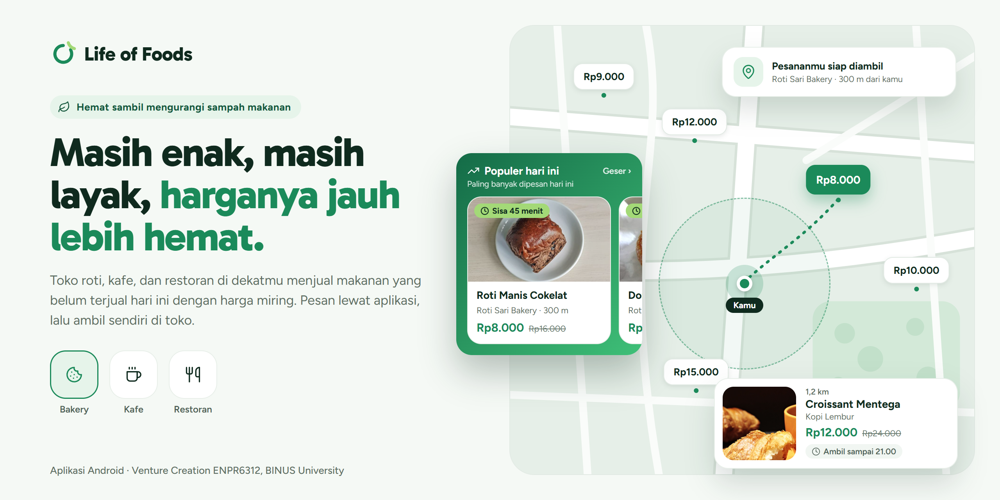
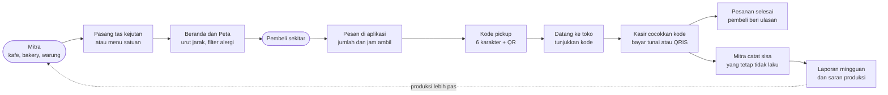

<p align="center">
  
</p>

# Life of Foods

[](https://github.com/Bambang-Saputra/Venture-Creation/actions/workflows/android-ci.yml)
[](https://github.com/Bambang-Saputra/Venture-Creation/actions/workflows/api-ci.yml)

Aplikasi Android untuk membeli makanan yang belum terjual hari ini dari toko roti, kafe, dan restoran di sekitarmu, dengan harga jauh lebih murah. Makanannya masih enak dan layak dimakan, hanya saja tidak habis sebelum toko tutup. Pembeli memesan lewat aplikasi, datang ke toko di jam yang ditentukan, menunjukkan kode pesanan ke kasir, lalu membayar tunai atau QRIS di tempat.

**Mata kuliah:** Venture Creation (ENPR6312), BINUS University
**Isu:** SDG 12, konsumsi dan produksi yang bertanggung jawab

---

## Daftar Isi

1. [Apa Itu Life of Foods?](#apa-itu-life-of-foods)
2. [Coba Aplikasinya](#coba-aplikasinya)
3. [Masalah dan Solusi](#masalah-dan-solusi)
4. [Fitur Utama](#fitur-utama)
5. [Model Bisnis](#model-bisnis)
6. [Status Pengerjaan](#status-pengerjaan)
7. [Tech Stack](#tech-stack)
8. [Struktur Repo](#struktur-repo)
9. [Menjalankan dari Source Code](#menjalankan-dari-source-code)
10. [Aturan Kerja](#aturan-kerja)
11. [Desain](#desain)
12. [Banner dan Aset](#banner-dan-aset)

---

## Apa Itu Life of Foods?

Jam 9 malam di sebuah bakery di Tebet. Masih ada belasan roti di etalase, dan toko tutup sebentar lagi. Besok pagi roti itu tidak lagi dijual, jadi biasanya dibuang. Di saat yang sama, ada orang beberapa ratus meter dari sana yang mau makan malam enak tanpa keluar banyak uang.

**Life of Foods mempertemukan keduanya.** Toko memasang makanan yang belum terjual di aplikasi, pembeli di sekitar memesannya dengan harga jauh lebih murah, lalu mengambilnya sendiri sebelum toko tutup. Makanan bisa dijual satuan, atau dikemas dalam satu paket campur berisi beberapa jenis dengan harga lebih hemat lagi (di aplikasi disebut "tas kejutan").

Ada tiga prinsip yang kami pegang:

- **Jujur soal isi.** Kandungan, alergen, dan status halal ditulis apa adanya. Halal bersertifikat menyebut nomornya, klaim mitra ditulis sebagai klaim, dan yang tidak disebutkan ditulis "tidak disebutkan".
- **Nyaman dipakai.** Pesan dalam beberapa ketukan, tanpa top up dan tanpa dompet digital. Bayar di toko seperti biasa.
- **Aturan yang jelas.** Jam buka, jam ambil, dan batas waktu tampil di setiap jualan. Kode pickup kedaluwarsa 30 menit setelah jam ambil lewat, dan stoknya kembali ke mitra.

### Alur aplikasi



Panah putus-putus adalah bagian yang membedakan Life of Foods dari sekadar aplikasi diskon: dari catatan sisa harian, mitra mendapat laporan mingguan dan saran jumlah produksi, sehingga sisanya makin sedikit dari minggu ke minggu.

---

## Coba Aplikasinya

**Unduh APK:** [folder Google Drive "Aplikasi"](https://drive.google.com/drive/folders/1yR7UVr51-BgEAXpmtjM6qg_KC0I1S9Y3). Pilih file `Life-of-Foods-….apk` dengan tanggal paling baru. Aplikasi ini belum ada di Play Store.

**Cara install di HP Android (minimal Android 8.1):**

1. Unduh file APK dari folder di atas, lalu buka file tersebut.
2. Jika muncul *"Install unknown apps"*, izinkan untuk browser atau aplikasi file yang dipakai.
3. Jika Google Play Protect memberi peringatan, pilih **More details**, lalu **Install anyway**. Peringatan ini muncul karena aplikasi tidak dipasang dari Play Store.

**Cara mencoba:**

| Ingin mencoba | Caranya |
|---|---|
| Alur pembeli | Pilih peran **Pembeli**, masuk dengan nomor HP, isi profil dan alergi, lalu pesan dari Beranda |
| Alur mitra | Pilih peran **Mitra**. Nomor yang belum terdaftar diarahkan ke formulir **Daftar usaha**, lalu menunggu tim menyetujui |
| Menukar kode | Pesan dari HP pembeli, lalu buka **Cocokkan kode** di HP mitra dan ketik kodenya atau pindai QR-nya |

> **Perlu diketahui selama uji coba:**
> - Server aplikasi masih berjalan di laptop tim, jadi aplikasi hanya bisa dipakai saat sesi demo berlangsung. Di luar jam itu, aplikasi akan gagal memuat data.
> - Kode OTP belum dikirim lewat SMS atau WhatsApp. Kodenya langsung muncul di layar dengan tanda "mode uji coba".
> - Pembayaran tidak dilakukan di aplikasi. Pembeli membayar langsung di toko, dan aplikasi hanya mencatat transaksinya.

---

## Masalah dan Solusi

**Masalah.** Dunia membuang sekitar 1,05 miliar ton makanan pada 2022, kira-kira seperlima dari makanan yang tersedia untuk konsumen ([UNEP Food Waste Index Report 2024](https://www.unep.org/resources/publication/food-waste-index-report-2024)). Di level toko, makanan yang tidak terjual sebelum tutup menjadi kerugian langsung bagi pemilik usaha. Too Good To Go menyelesaikan masalah ini di Eropa tapi belum masuk Indonesia, sedangkan aplikasi lokal yang ada belum menonjolkan kejujuran soal isi dan harga.

**Solusi.** Life of Foods memberi mitra jalur cepat untuk menjual sisa hari itu, dan memberi pembeli alasan untuk percaya:

- Mitra memasang tas kejutan atau menu satuan dalam hitungan detik, dengan cetakan tas yang bisa dipakai ulang setiap hari.
- Pembeli melihat jualan terdekat, langsung tersaring sesuai alergi di profilnya.
- Pesanan dikunci dengan kode pickup, jadi mitra tidak perlu menyimpan makanan untuk orang yang tidak datang.
- Jualan yang tetap tidak laku otomatis masuk catatan sisa, jadi mitra tinggal memeriksa. Dari catatan itu mitra mendapat laporan rupiah mingguan dan saran produksi untuk mengurangi sisa di hari berikutnya.

---

## Fitur Utama

Kode di dalam kurung adalah nomor layar: K untuk layar konsumen (pembeli), M untuk layar mitra (toko). Nomornya mengikuti [peta layar Figma](docs/figma/peta-layar.md), kecuali M22 yang hanya ada di aplikasi.

### Untuk pembeli

| Fitur | Keterangan |
|---|---|
| Pengenalan aplikasi (K06) | Tiga halaman pengenalan sebelum masuk, halaman terakhir meminta izin lokasi |
| Masuk (K02-K05) | Masuk dengan nomor HP dan kode OTP, lengkapi profil, simpan alergi dan pantangan |
| Beranda (K07) | Cari, kategori, "Tutup kurang dari satu jam", Populer hari ini, Terdekat dari kamu, banner iklan mitra, tarik layar ke bawah untuk memuat ulang |
| War harga (K07) | Kotak "War harga terbaik" berisi jualan dengan diskon terbesar hari itu beserta hitung mundurnya, plus jendela promo yang muncul sekali setiap aplikasi dibuka |
| Peta (K08) | Harga tiap toko tampil di peta, tab Daftar diurutkan dari yang terdekat, dan rute bisa dibuka di aplikasi peta seperti Google Maps |
| Filter (K09) | Jenis jualan, alergi yang dihindari (terisi dari profil), pola makan, halal, jarak, dan jam ambil |
| Detail jualan (K10, K11) | Foto, harga normal dan harga jual, stok, jam ambil, kandungan, status halal apa adanya, rating toko, bagikan jualan ke WhatsApp |
| Ringkasan pesanan (K12, K13) | Satu tas utuh atau beberapa menu satuan dari toko yang sama, pasang voucher. Total harga dihitung ulang oleh sistem, jadi tidak bisa diakali dari HP |
| Kode ambil pesanan (K14) | Kode 6 karakter dan QR untuk ditunjukkan ke kasir, status pesanan yang langsung diperbarui, tombol batalkan, jumlah porsi yang diselamatkan |
| Pesanan saya (K15) | Pesanan aktif dan riwayat, beri ulasan setelah pesanan selesai |
| Favorit dan notifikasi (K16, K17) | Simpan toko, pengingat 30 menit sebelum jam ambil, kabar saat toko favorit memasang jualan. Notifikasi di HP untuk war harga, paling banyak dua kali sehari |
| Voucher dan Gosok & Menang (K22) | Klaim voucher dari jendela promo, main Gosok & Menang sekali sehari, pakai voucher di ringkasan pesanan. Potongan ditanggung Life of Foods, bukan mitra |
| Profil (K18-K20) | Ubah profil dan alergi, Voucher saya, pengaturan notifikasi, hapus akun |

### Untuk mitra

| Fitur | Keterangan |
|---|---|
| Daftar usaha (M03, M04) | Pendaftaran dari aplikasi tanpa KTP, NIB opsional, disetujui tim sebelum toko tampil |
| Dashboard (M05) | Kerugian yang tertahan minggu ini, pesanan menunggu, sisa harian rata-rata 7 hari |
| Catat sisa (M06, M19) | Jualan yang tidak laku hari itu terisi otomatis, mitra tinggal memeriksa. Hitung per item atau timbang per kilogram; nilai rupiah disimpan saat dicatat |
| Laporan dan saran (M07, M08) | Laporan mingguan dan saran jumlah produksi berdasarkan catatan sisa |
| Pasang dan kelola jualan (M09, M10, M16, M17) | Form tas kejutan terpandu 4 langkah, menu satuan, foto jualan, jeda jualan. Harga normal tidak boleh lebih murah dari harga jual |
| Pesanan masuk (M11, M21) | Catatan pembeli dan alergi tampil langsung di kartu pesanan, riwayat dengan "Muat lebih banyak" |
| Cocokkan kode (M12, M18) | Kasir mengetik kode atau memindai QR pembeli. Kode yang sudah dipakai atau milik toko lain ditolak, dan setiap penukaran tercatat |
| Saldo (M13) | Riwayat transaksi; pencairan tampil tapi nonaktif selama uji coba |
| Profil dan pengaturan toko (M14, M15) | Foto, jam buka, anggota toko dengan peran pemilik atau kasir |
| Promosikan toko (M22) | Pasang iklan per hari tayang: prioritas pencarian atau banner Beranda |

---

## Model Bisnis

| Sumber | Tarif | Keterangan |
|---|---|---|
| Biaya layanan | Rp1.000 per pesanan, dibayar pembeli | Sumber utama. Di awal ditanggung lewat voucher: gratis untuk pesanan pertama dan untuk program ajak teman. Sudah tercatat di setiap pesanan, dan tarifnya bisa diubah tanpa memperbarui aplikasi |
| Prioritas pencarian | Rp5.000 per hari tayang | Sukarela dari mitra. Paling banyak 2 jualan berlabel "Iklan" di atas daftar utama. Filter alergi tetap berlaku |
| Banner Beranda | Rp10.000 per hari tayang | Sukarela dari mitra. Tampil di Beranda pembeli. Terpisah dari "Populer hari ini", yang murni dihitung dari pesanan |

**Mitra tidak membayar langganan maupun komisi.** Mitra sengaja melebihkan produksi supaya tidak kehabisan, jadi alat untuk "mengurangi produksi" bukan hal yang mau mereka bayar, dan di awal mitra adalah sisi yang paling sulit dicari. Laporan sisa dan saran produksi tetap gratis untuk membantu mitra tahu berapa kelebihan yang masih wajar. Kelebihan itulah yang disalurkan lewat aplikasi, sehingga pendapatan datang setiap kali makanan terselamatkan, bukan dari makanan yang terbuang.

**Voucher di awal** menjaga harga tetap menarik: biaya layanan tetap tampil tapi dicoret ("ditanggung Life of Foods"), dan berlaku dengan batas yang jelas supaya pembeli tidak kaget saat promo berakhir. Program ajak teman sekaligus memanfaatkan temuan riset bahwa pengaruh sosial paling mendorong orang mau mencoba.

**Voucher diskon makanan (uji coba).** Selain voucher biaya layanan, aplikasi sudah punya voucher potongan harga makanan: voucher pop up (misalnya 20%, maksimal Rp10.000) dan hadiah Gosok & Menang (sampai 50%, maksimal Rp20.000). Potongan ini ditanggung Life of Foods, bukan mitra, dan dicatat di saldo mitra. Besarnya masih lebih tinggi dari anggaran voucher Rp1.000 per pesanan di BMC, jadi nilainya perlu disesuaikan sebelum dipakai di luar uji coba. Nilainya bisa diubah tanpa memperbarui aplikasi.

Selama uji coba semuanya gratis: biaya layanan Rp0, tagihan iklan belum memotong saldo, dan tim tidak memegang uang mitra karena pembeli membayar langsung di toko.

---

## Status Pengerjaan

| Bagian | Status |
|---|---|
| Alur pembeli dari awal sampai akhir (K01-K20) | Selesai dan tersambung ke server |
| Alur mitra: pasang jualan, pesanan, cocokkan kode, catat sisa, laporan | Selesai dan tersambung ke server |
| Rating dan ulasan | Selesai |
| War harga, pop up promo, dan notifikasi sistem | Selesai |
| Voucher dan Gosok & Menang | Selesai; nilai voucher masih menunggu keputusan tim |
| Iklan per hari tayang | Selesai, tagihan sungguhan belum aktif |
| Upload foto oleh mitra | Selesai |
| Pendaftaran mitra dari aplikasi | Selesai; persetujuannya masih dilakukan tim secara manual |
| Uji otomatis | 167 uji server dan 175 uji aplikasi Android, dijalankan otomatis setiap ada perubahan kode |
| Masuk dengan akun Google | Kode sudah siap, tinggal pengaturan di Google Cloud |
| Kode OTP lewat SMS atau WhatsApp | Belum; selama uji coba kodenya muncul di layar |
| Server yang menyala terus | Belum; masih di laptop tim |
| Pembayaran online | Ditunda; pembeli membayar di toko |
| Rilis di Play Store | Belum |

Daftar lengkapnya ada di [docs/rencana-lanjutan.md](docs/rencana-lanjutan.md).

---

> Bagian di bawah ini untuk developer yang ingin membaca atau menjalankan kode.

## Tech Stack

| Bagian | Pilihan |
|---|---|
| Aplikasi | Android, **Java** + XML views, ViewBinding, Navigation Component, RecyclerView |
| Jaringan | Retrofit 2 + OkHttp + Gson |
| Gambar | Glide, dilayani dari `/storage` milik API |
| API | **Laravel 13**, PHP 8.3, Sanctum |
| Database | **MySQL 8.4**, InnoDB, utf8mb4 |
| SDK Android | `minSdk 27` (Android 8.1) · `compileSdk 36` · `targetSdk 36` |
| Peta | osmdroid + OpenStreetMap tanpa API key (ADR-0005); jarak dihitung server |
| Pindai QR | zxing-android-embedded |
| Notifikasi | WorkManager memeriksa API secara berkala, tanpa Firebase |
| Server uji | Laragon di laptop + ngrok, dengan cadangan hotspot LAN |
| CI | GitHub Actions: uji API, lint + uji + build APK debug, gitleaks, pemeriksaan judul PR |

Alasan di balik pilihan besar (Laravel, Java alih-alih Kotlin, monorepo, peta tanpa API key) tercatat di [docs/adr/](docs/adr/).

---

## Struktur Repo

```
api/         Laravel 13: REST API di /api, seeder demo dan pilot
android/     aplikasi Android (Java), satu APK untuk pembeli dan mitra
db/          ERD dan kamus data
docs/
├── adr/       keputusan teknis beserta alasannya
├── api/       kontrak REST
├── aset/      banner promosi dan sumber foto
├── figma/     peta 44 layar Figma ke fitur, endpoint, dan tabel
└── panduan/   setup Windows, alur kerja git, pola layar Java
data-pilot/  tempat CSV mitra sungguhan (di-gitignore, hanya contoh yang masuk repo)
```

---

## Menjalankan dari Source Code

Kebutuhan: Laragon (PHP 8.3, MySQL 8.4, Composer), JDK 21, dan Android SDK. Langkah lengkapnya ada di [docs/panduan/setup-windows.md](docs/panduan/setup-windows.md).

**API**

```bash
cd api
composer install
cp .env.example .env
php artisan key:generate
php artisan migrate:fresh --seed   # HANYA sekali saat instalasi baru, lihat peringatan di bawah
php artisan storage:link
php artisan serve                  # http://127.0.0.1:8000/api
php artisan schedule:work          # terminal kedua: tutup pesanan lewat jam, pengingat ambil, notifikasi war
```

> **Peringatan:** `migrate:fresh` menghapus semua tabel, termasuk akun penguji dan data mitra. Setelah database uji coba terisi, jangan jalankan lagi. Setelah menarik kode terbaru, cukup jalankan `composer install` lalu `php artisan migrate`. Perintah artisan dengan `--env=testing` juga tetap memakai `.env` (database uji coba) karena repo ini tidak punya `.env.testing`; database tes `life_of_foods_test` hanya dipakai oleh `php artisan test`. Buat cadangan dengan `mysqldump` sebelum mengubah skema.

**Sebelum tiap sesi uji coba atau demo**

Nyalakan MySQL, `php artisan serve`, `php artisan schedule:work`, dan ngrok (domain yang sama dengan `API_BASE_URL` di APK), lalu:

```bash
php artisan demo:segarkan
```

Jualan demo hanya tampil di hari yang sama, jadi sehari setelah seeding Beranda akan kosong. Perintah ini mengisi lagi data demo supaya aplikasi terasa aktif: jualan hari ini dan besok (dengan foto dan alergen), banner dan iklan prioritas pencarian, pesanan hari ini untuk "Populer hari ini", serta ulasan untuk rating toko. Tidak ada data yang dihapus, dan yang disentuh hanya akun serta toko demo bernomor `62811000…`, jadi akun penguji dan mitra sungguhan aman. Aman dijalankan berulang kali, dan menolak berjalan di production kecuali memakai `--force`.

Akun mitra demo untuk masuk di halaman mitra: `62811000201` sampai `62811000208` (Roti Sari Bakery paling lengkap). Kode OTP tampil di layar selama `PILOT_MODE=true`.

**Pengaturan selama uji coba**

| Hal | Cara kerjanya sekarang |
|---|---|
| Server | API berjalan di laptop tim dan dibuka ke internet lewat ngrok |
| OTP | Belum memakai gateway SMS atau WhatsApp berbayar. `PILOT_MODE=true` menampilkan kode di layar dengan spanduk "mode uji coba" |
| Biaya layanan | Kolom `service_fee` tercatat di setiap pesanan. Tarifnya diatur lewat `SERVICE_FEE` di `.env`, sekarang 0 (ADR-0004) |
| Voucher | Nilainya ada di tabel `vouchers`. Potongan dicatat sebagai penyesuaian saldo mitra (ADR-0008) |
| Persetujuan mitra | `php artisan mitra:setujui` (ADR-0007) |
| Login Google | Kodenya siap (ADR-0006), tapi tombolnya tersembunyi selama client ID di Google Cloud Console belum diisi |
| Notifikasi | WorkManager memeriksa API secara berkala, tanpa Firebase |
| APK | Mendorong tag `v*` menjalankan workflow `android-apk-rilis`, yang membangun APK debug dan melampirkannya di [Releases](https://github.com/Bambang-Saputra/Venture-Creation/releases). APK uji coba saat ini dibagikan lewat folder Google Drive di bagian [Coba Aplikasinya](#coba-aplikasinya) |

**Android**

Buat `android/local.properties` dan isi `API_BASE_URL`. Kosongkan untuk emulator (bawaannya `http://10.0.2.2:8000/api/`), atau isi URL ngrok + `/api/` untuk HP fisik.

```bash
cd android
./gradlew installDebug                                            # pasang ke HP atau emulator
./gradlew spotlessCheck lintDebug testDebugUnitTest assembleDebug # pemeriksaan yang sama dengan CI
```

---

## Aturan Kerja

- Branch: `<tipe>/<lingkup>-<deskripsi>`, contoh `fitur/api-kode-pickup`. Hanya ada `main`.
- Commit: Conventional Commits berbahasa Indonesia, contoh `feat(api): tambah endpoint penukaran kode pickup`.
- **Push selalu lewat skill `/qc`**, yang membaca kode sebelum commit dan menolak atribusi AI.
- PR: CI hijau, satu persetujuan dari anggota lain, tangkapan layar untuk perubahan UI, squash merge. Aturan ini disepakati tim, belum dipaksakan lewat pengaturan GitHub.
- `.env` dan data mitra sungguhan tidak pernah masuk repo.

Selengkapnya di [docs/panduan/alur-kerja-git.md](docs/panduan/alur-kerja-git.md).

---

## Desain

Prototipe Figma **Life of Foods v2**, 44 layar: 23 layar konsumen (K01-K23) dan 21 layar mitra (M01-M21). Layar M22 (Promosikan toko) dibuat langsung di aplikasi dan belum ada di Figma. Pemetaan tiap layar ke fitur, endpoint, dan tabel ada di [docs/figma/peta-layar.md](docs/figma/peta-layar.md).

Perubahan warna, tipografi, jarak, dan komponen dilakukan di Figma lewat variables dan styles, bukan di layar satu per satu. Di aplikasi, warnanya ada di `android/app/src/main/res/values/colors.xml` dengan font Gabarito (judul) dan Figtree (teks).

---

## Banner dan Aset

| Berkas | Ukuran | Dipakai untuk |
|---|---|---|
| [docs/aset/banner-readme.png](docs/aset/banner-readme.png) | 2560×1280 | Bagian atas README ini dan social preview repo |
| [docs/aset/banner-promosi.png](docs/aset/banner-promosi.png) | 1080×1350 | Unggahan Instagram, WhatsApp, dan poster BIFEST |

Keduanya dibuat dari satu berkas HTML, [docs/aset/banner/banner.html](docs/aset/banner/banner.html). Cara mengubah teks lalu membuat ulang PNG-nya ada di [docs/aset/banner/README.md](docs/aset/banner/README.md).

Foto makanan di banner dan data demo berlisensi Creative Commons atau Pexels License; sumber dan pembuatnya tercatat di [api/database/seeders/foto-demo/SUMBER.md](api/database/seeders/foto-demo/SUMBER.md) dan [docs/aset/SUMBER-foto-onboarding.md](docs/aset/SUMBER-foto-onboarding.md).
